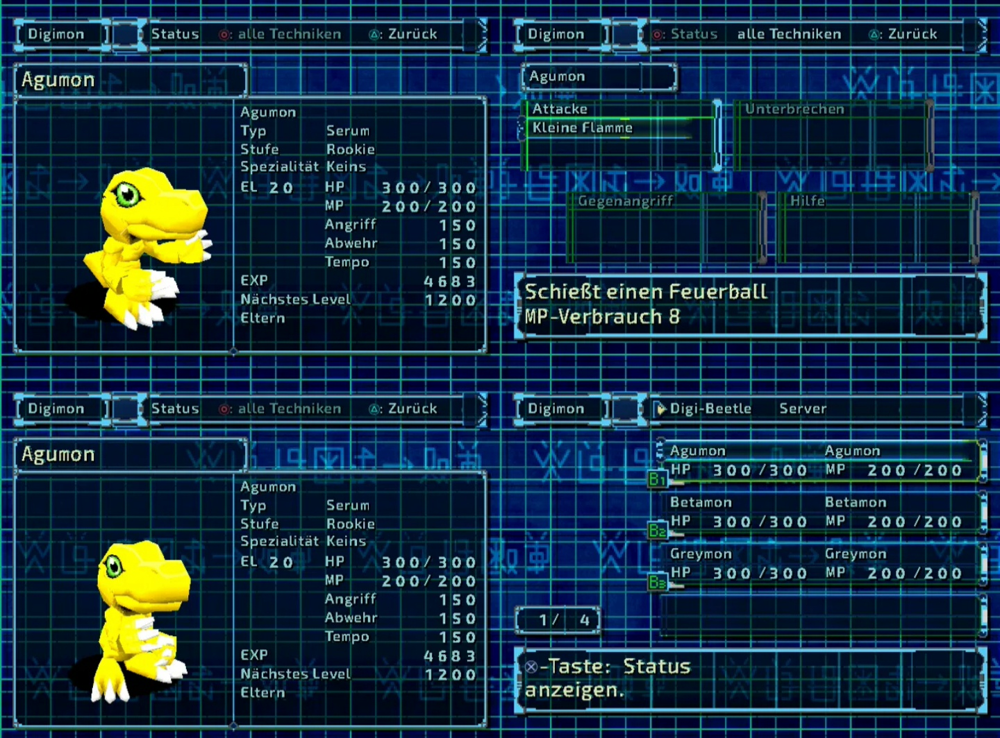

# Digimon World 2 – PC Port

**Native Fassung für Windows x64 und Linux x64 | aktuelle Version: 1.6.0 | in Entwicklung: 1.6.2 (Branch `development/v1.6.2`)**

Nativer PC-Port von **Digimon World 2 (USA, SLUS-01193)** mit hoher Auflösung, Breitbild, moderner Oberfläche, deutscher Sprache, Modding und Cheat-Menü. Das Spiel selbst (Regeln, Werte, Ablauf) bleibt das Original.

> **Keine Spieldaten:** Repository und Downloads enthalten keine Daten aus dem Spiel. Du brauchst dein eigenes, rechtmäßig erworbenes Image von *Digimon World 2 (USA)*.

## Download

- **[Aktuelle Version](https://github.com/emrah1818/dw2-pc-port/releases/latest)** – `DW2-PC-Port-windows-x64.zip` oder `DW2-PC-Port-linux-x64.zip`
- **[Alle Releases](https://github.com/emrah1818/dw2-pc-port/releases)** – ältere Versionen und Vorabversionen

## Installation

1. Zip entpacken.
2. Dein Image (`.cue` + `.bin`, `.img` oder rohes `.iso`) in den Ordner `DW2-PC` legen.
3. `dw2.exe` starten (Linux: `./dw2`). Beim ersten Start entsteht aus deinem Image das Datenpaket `dw2.pak` (etwa 406 MB). Alle 3675 Dateien werden geprüft, ein falsches Image wird abgelehnt.
4. Sprache wählen (Deutsch oder Englisch). **F1** öffnet die PC-Einstellungen, am Controller Select eine Sekunde halten.

Fehlt das Image, erklärt das Programm, was es braucht. Spielstände und Einstellungen liegen in `%APPDATA%\DW2-Online\` bzw. `~/.local/share/DW2-Online/`. Die ausführliche Anleitung steht in [README_PORT.md](README_PORT.md).

## Stand der Funktionen

Die Spalte „Geprüft“ sagt, wie weit eine Funktion nachgewiesen ist: **Spiel** = im laufenden Spiel mit echtem Image, **Nutzer** = auf echter Windows-Hardware (GTX 1070), **Auto** = automatischer Test ohne Spieldaten, **CI** = nur gebaut.

### Funktioniert

| Bereich | Inhalt | Geprüft |
|---|---|---|
| Start aus eigenem Image | Import, Prüfung, Meldung bei fehlendem oder falschem Image | Spiel, Auto |
| Speichern und Laden | Spielstände bleiben zwischen den Versionen kompatibel | Spiel (9/9) |
| Auflösung | 1× bis 12× (240 bis 2880 Zeilen) oder automatisch nach Fenstergröße; 720p, 1080p, 1440p, 4K | Spiel, Nutzer |
| Seitenverhältnis | 4:3, 16:9, 21:9 mit echtem Breitbild der 3D-Szene | Spiel, Nutzer (16:9, 21:9) |
| Original-Darstellung | bildgleich mit der PS1-Ausgabe (Referenzbilder 6/6) | Spiel |
| Sprachwahl | Deutsch oder Englisch beim ersten Start und am Titelbild | Spiel |
| Deutsche Übersetzung | 2583 Texte: Story, Dialoge, Menüs, Items, Kampf; Attackennamen nach der Anime-Tabelle; Typen Serum, Datei, Virus | Spiel (Stichproben), Auto (Skriptprüfung) |
| Schriften | Exo 2, Orbitron, Roboto Mono in Ausgabeauflösung, Lizenztexte liegen bei | Spiel, Auto |
| Moderne Oberfläche | Kampf, Dialoge, Digimon-Status, Digi-Labor, Technik-Erlernen | Spiel, Nutzer |
| Steuerung | Tastatur und Gamepad frei belegbar, PlayStation-Tastensymbole | Auto; Controller auf echter Hardware offen |
| Cheat-Menü | Werte lesbar und bearbeitbar, Sicherung und Rückgängig | Spiel (31/31) |
| Lexikon (F1) | alle Digimon aus den Tabellen der eigenen Disc | Spiel |
| Leistung | flüssig auf GTX 1070 (Median 16,7 ms) | Nutzer |

### Teilweise funktionsfähig

| Bereich | Stand |
|---|---|
| Grafikfilter | Vorhanden: Nearest, Bilinear (3D), 2D-Glättung, Schärfen, Korrektur gegen Polygonzittern (PGXP). Offen: FXAA, SMAA, MSAA, trilineare und anisotrope Filterung, Farb- und Kontrastregler. |
| Grafikprofile | Original, Balanced, HD, Ultra (neu in 1.6.2-dev). Automatisch geprüft, im Spiel noch nicht angesehen. |
| FPS-Anzeige | F1 → Grafik: aus, FPS, FPS und Details (neu in 1.6.2-dev). Bisher nur kompiliert, im laufenden Spiel noch nicht angesehen. |
| HD-Texturpakete | PNG-Pakete in beiden Renderern, `--dump-textures`, siehe [doc/TEXTURPAKETE.md](doc/TEXTURPAKETE.md). Offen: JPG, Verwaltung im Menü. |
| Export bearbeitbarer Daten | `--export-assets` (Texturen, Tabellen, Originaldateien) und `--export-texts`. Offen: Angebot beim ersten Start, Audio. |
| Moderne Oberfläche, übrige Menüs | Inventar, Speichern/Laden und Hauptmenü nutzen noch das alte Fensterlayout. |
| Deutsche Wortgrafiken | Kampf, Titel und Attackennamen übersetzt; seltene Kampfzustände noch nicht im Spiel ausgelöst. |

### Noch offen

- Integrierter 3D-Viewer als eigener Menüpunkt.
- Vollständiger Story-Durchlauf und Durchsicht aller deutschen Texte im Spiel.
- Controller, Ton und Vollbild auf weiterer Windows-Hardware (AMD, Intel).

## Bekannte Einschränkungen

- **Gelbe, flackernde Pyramide im Kampf** (gemeldet bei ToyAgumon und ClearAgumon): bisher nicht nachgestellt. Smooth Frames ausschalten (F9) hilft vermutlich.
- Der GPU-Renderer braucht Vulkan. Ohne passenden Treiber unter F1 → Grafik den Software-Renderer wählen.
- Das Programm ist nicht signiert, Windows SmartScreen kann warnen.
- Leistung ist nur auf einer GTX 1070 gemessen, nicht mit 6× und 9× und nicht im Original-Profil.

## Deutsche Übersetzung – Bildschirmfoto vom 7.11.2026

*Statusansicht, Techniken, Agumon-Modell und Teamübersicht mit deutscher Oberfläche. Das Bild zeigt den Stand vom 7.11.2026.*

## Dokumentation

- [README_PORT.md](README_PORT.md) – Bedienung, Tasten, Sprache, Modding, Cheats
- [TESTBERICHT.md](TESTBERICHT.md) – was je Version getestet ist und was nicht
- [doc/V1.6.2_PLAN.md](doc/V1.6.2_PLAN.md) – Arbeitsstand der Version 1.6.2
- [PROJECT_STATUS.md](PROJECT_STATUS.md) – Architektur und technische Erkenntnisse
- [GRAFIKTEXTE.md](GRAFIKTEXTE.md), [CHEATS.md](CHEATS.md), [doc/FONTS.md](doc/FONTS.md)

## Herkunft und Rechte

Der Port ist ein Fork von [Wyrelade/DW2-PC](https://github.com/Wyrelade/DW2-PC) (Commit `1dbb32a`, CC0), einer vollständigen Dekompilierung des Spiels mit eigener PC-Laufzeit (SDL3). Die Lizenz des Codes steht in [LICENSE](LICENSE), die Schriftlizenzen (SIL OFL) in `misc/fonts/`.

**Digimon World 2** und alle Spielinhalte gehören ihren Rechteinhabern. Dieses Repository stellt keine Spielkopie bereit. Die deutsche Übersetzung ist eine inoffizielle Fan-Übersetzung.
